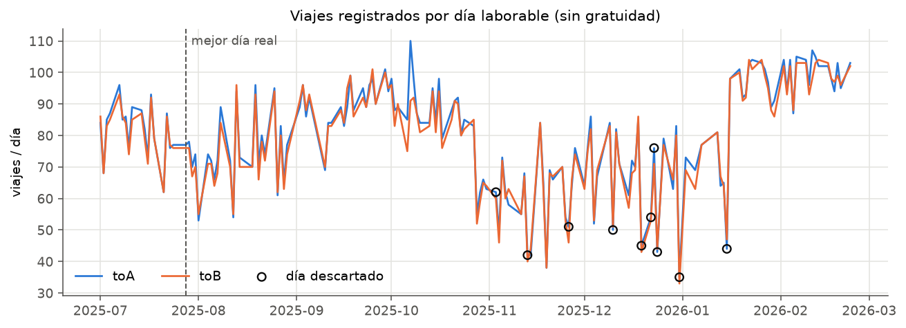
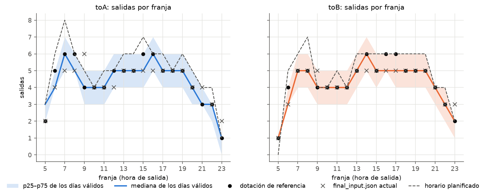
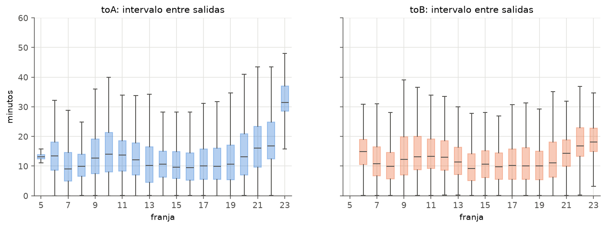
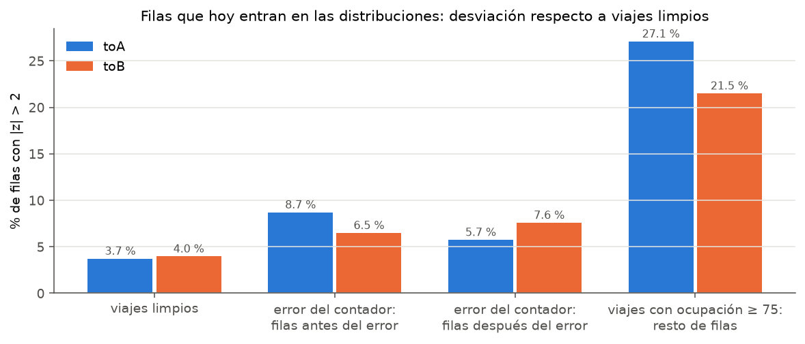
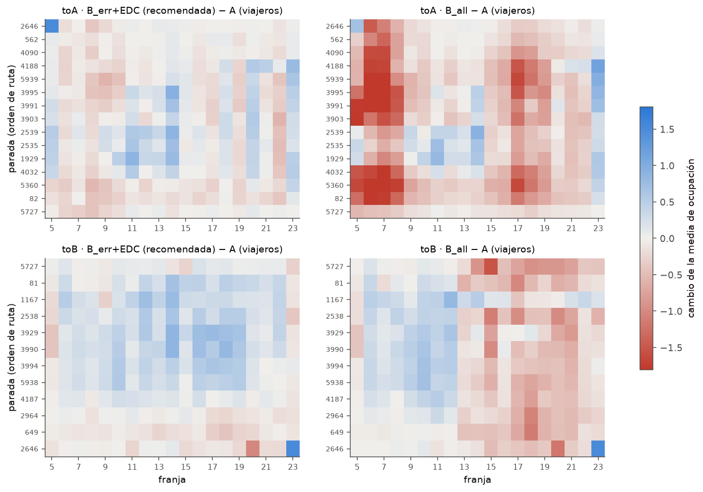
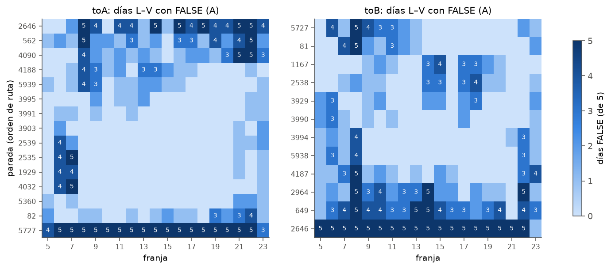
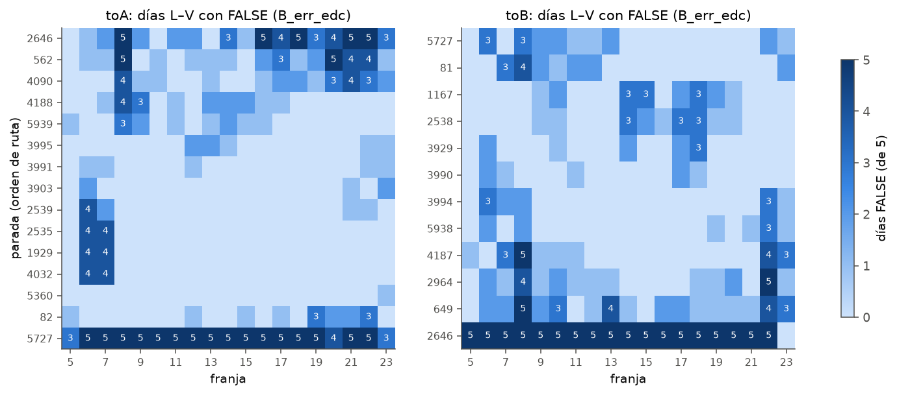
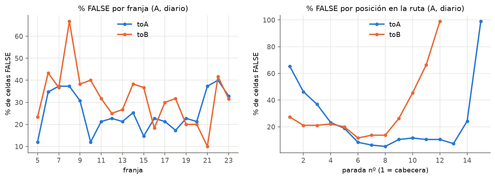

# Línea 401 (E01): oferta de viajes y distribuciones de ocupación

Análisis sobre la copia de `DATOS/data` en `AAA_TEST/data` (1 jul 2025 – 23 feb 2026), **solo laborables sin gratuidad** (`DayType == "LA"` y `FreeDay == 0`), todos los laborables (L–V) tratados como un único tipo de día. Sentidos con la convención del notebook y la web: **toA = `Direction 2`, sale de 2646 y acaba en 5727**; **toB = `Direction 1`, sale de 5727 y acaba en 2646**.

Las funciones estadísticas son las de `DATOS/src` sin tocar; el pipeline de ocupación reproduce `analisis_ALL_OCCUPATION.ipynb` exactamente (mismas medias, desviaciones e `IsNormal` en las 513 celdas exportadas).

## Resumen

**Oferta y dotación de referencia**
- Los datos no recogen toda la oferta: registran ~167 viajes/día en mediana frente a 191 planificados (≈ 87 %). Lo que varía de un día a otro es **cuántos coches con contador hay en la línea** (correlación 0,80), no el servicio.
- Hay **787 registros que no son expediciones distintas**: 714 viajes partidos en dos `TripId`, 58 duplicados y 15 reinicios. Se juntan en un solo viaje.
- **Dotación de referencia:** `output/part1/reference_allocation.json`, en el formato de `final_input.json`. Tiene 84 + 83 viajes y 13 coches, y a ±1 salida de la mediana de los 148 días válidos en cada franja (distancia 7, frente a 11 del `final_input.json` actual). Ningún día real sirve tal cual: solo 19 de 148 tienen las cadenas de coches coherentes, 7 de ellos con un número de coches típico, y el mejor de esos 7 está a distancia 19.
- **Para la oferta no hay que quitar viajes por anomalías de conteo** (se perdería el 11 % de los viajes reales). Solo hay que juntar duplicados y trozos.

**Distribuciones de ocupación**
- **Sí conviene quitar el viaje entero cuando el contador falla.** En los viajes con ocupación negativa, subidas o bajadas fuera de rango o ruptura de conservación, el resto de filas, que hoy sí entran en las distribuciones, se desvía 1,5–2,3 veces más que en los viajes limpios, **tanto antes como después del error**. El contador de ese viaje no es fiable desde el principio.
- **No conviene hacerlo con la ocupación ≥ 75.** Son mayoritariamente buses llenos de verdad: el valor mediano es 78, se concentran en la punta de cada sentido (toA 5–7 h, toB 14–18 h) y el resto del viaje también va alto. Quitarlos enteros baja la media de las celdas punta hasta 2,7 viajeros (48 celdas de toA bajan más de 1).
- **Variante recomendada, «B_err+EDC»:**
  - quitar el viaje entero ante un error del contador;
  - quitar también el viaje entero de cada fila que el test EDC marca como outlier;
  - la ocupación ≥ 75 se sigue quitando solo como fila.
  - Distribuciones normales: toA 94,4 % → **95,8 %** y toB 88,6 % → **96,1 %** (versión diaria: 74,5 → 79,4 y 67,9 → 76,1).
  - Cuesta el 6,6 % y el 9,8 % de los viajes, y las medias apenas cambian (0,2 viajeros de media, 1,5 como máximo).
  - Ficheros listos para usar: `output/part2/NORMAL_OCCUPATION_to{A,B}_B_err_edc.csv`.

**Distribuciones FALSE**
- Se concentran donde la normal no encaja físicamente:
  - **Terminales:** el ~99 % de las celdas diarias son FALSE, porque ahí se baja todo el mundo (efecto suelo en 0).
  - **Extremos de la ruta con poca ocupación:** primeras paradas de toA y últimas de toB.
  - **Franja 23:** muestras de 100–230 viajes con asimetría moderada.
  - **Celdas punta con ocupación media ≥ 40:** el corte en 75 recorta la cola derecha.
- Con ocupación media < 5 el 92 % son FALSE; con 20–40, solo el 7 %. Los lunes tienen algo más de FALSE.


---

## 1. Oferta de viajes

### 1.1 Qué hay en los datos

| | toA | toB |
|---|---|---|
| Días laborables sin gratuidad | 158 | 158 |
| Días válidos para la oferta | 148 | 148 |
| Viajes registrados (todos los días) | 12.951 | 12.860 |
| Viajes por día, mediana (días válidos) | 84 | 83 |
| Viajes con registro en todas las paradas | 54 % (15 de 15) | 54 % (12 de 12) |
| Duración mediana del viaje completo | 43,7 min | 41,5 min |

- **10 días descartados** por tener alguna franja de servicio (6–22 h) sin ninguna salida en algún sentido: 3, 13 y 26 nov; 10, 19, 22, 23, 24 y 31 dic; 15 ene. Son huecos de registro, no de servicio.
- **Registros que no son una expedición distinta** (se cuentan una sola vez):
  - 58 salidas repetidas al segundo con otro coche (el mismo servicio registrado dos veces);
  - 15 reinicios: el mismo coche vuelve a salir en el mismo sentido menos de 5 min después;
  - **714 viajes partidos en dos `TripId`**: mismo coche y sentido, el segundo trozo sale < 60 min después y empieza en una parada posterior a la última del primero (mediana: 6 paradas + 8 paradas). Sin juntarlos, 146 de los 148 días tenían algún coche con dos salidas seguidas en el mismo sentido.
- Primera y última salida (mediana): **5:26** y **23:25**.

### 1.2 La variabilidad entre días es de cobertura del APC, no de servicio



Los viajes registrados por día van de 76 a 208 (mediana 167, los dos sentidos). No es el servicio real lo que cambia:

- La correlación entre viajes/día y coches/día es **0,80** y cada coche hace ~14 viajes al día (p25–p75: 12,7–15,2). El volumen diario lo marca **cuántos coches con contador estuvieron en la línea**, que va de 5 a 17 según el día.
- El horario planificado de laborables (`NEW_ANAAL_FREQ/departures.csv`) tiene **98 + 93 = 191 expediciones**; la mediana registrada es 167 (≈ 87 %). Febrero llega a ~200/día y noviembre se queda en ~124.

| Mes | Días válidos | toA/día | toB/día | Coches/día |
|---|---|---|---|---|
| 2025-07 | 22 | 80,5 | 79,2 | 13,4 |
| 2025-08 | 20 | 74,6 | 72,8 | 11,0 |
| 2025-09 | 19 | 90,1 | 90,4 | 12,8 |
| 2025-10 | 23 | 84,5 | 81,6 | 11,0 |
| 2025-11 | 16 | 62,1 | 61,9 | 8,2 |
| 2025-12 | 15 | 73,0 | 72,0 | 9,9 |
| 2026-01 | 17 | 88,3 | 87,0 | 13,1 |
| 2026-02 | 16 | 100,2 | 99,0 | 13,9 |

Entre días de la semana apenas hay diferencia (toA: L 84,6 · M 80,3 · X 81,4 · J 82,1 · V 81,0), así que tratar L–V como un único día está justificado.

**Implicación:** la «oferta de los datos» es la de los coches instrumentados, ≈ 87 % de la planificada. La dotación de referencia reproduce eso, que es lo coherente con las distribuciones de ocupación (salen de esos mismos viajes). Si se quisiera simular la oferta real completa habría que partir del horario planificado.

### 1.3 Salidas por franja e intervalos





- Intervalo mediano entre salidas del mismo sentido: **11,6 min**. Por franja va de 9–11 min en punta (7–8 h y 13–19 h) a 14–17 min a partir de las 21 h y ~31 min en la última franja de toA.
- Hay mucho apelotonamiento: el **6,5 %** de los intervalos es < 2 min y el **17 %** < 5 min; el 4,7 % supera los 30 min.
- La tabla completa por franja (mediana, p10, p90 y la comparación con la dotación de referencia y con `final_input.json`) está en `output/part1/headways_per_slot.csv`.

### 1.4 Dotación de referencia

**Fichero: `output/part1/reference_allocation.json`** (mismo formato que `BASE_DATA/final_input.json`: coche → lista de `[cabecera, "H:MM"]`).

Ningún día real sirve tal cual: el día real más parecido al perfil típico que además tiene las cadenas de cada coche coherentes (los sentidos se alternan, sin solapes) y un número de coches típico es el 28 jul 2025, a distancia 19 del perfil; solo 7 de 148 días cumplen esas condiciones. Por eso la referencia se construye con los 148 días válidos:

1. **Salidas por sentido y franja:** el total diario mediano de cada sentido (84 y 83) repartido entre franjas según el perfil medio (redondeo por restos mayores). Queda a ±1 de la mediana en todas las franjas.
2. **Minuto de cada salida:** cuantiles de las horas reales de salida de esa franja y sentido en los 148 días, así que las salidas caen donde caen de verdad (no equiespaciadas).
3. **Coches:** encadenados con la duración mediana del viaje completo en cada franja (incluye la espera en terminal: el paso por la terminal coincide con la siguiente salida), asignando en orden de salida el coche que más lleva esperando. Sin posicionamientos en vacío, es la flota mínima para ese horario.

| | Viajes toA | Viajes toB | Coches | Distancia al perfil mediano* |
|---|---|---|---|---|
| **Dotación de referencia** | **84** | **83** | **13** | **7** |
| `final_input.json` actual | 82 | 81 | 12 | 11 |
| Mejor día real (28 jul) | 77 | 76 | 13 | 19 |
| Mediana de los días válidos | 84 | 83 | 12 | – |
| Horario planificado | 98 | 93 | – | – |

\* Suma, sobre las 38 celdas sentido × franja, de la diferencia absoluta con la mediana de salidas de los días válidos.

También se guardan `reference_real_day.json` (el 28 jul) y `reference_candidates.csv` (los 148 días ordenados por parecido).

### 1.5 ¿Quitar el viaje entero cuando una fila es anómala? (oferta)

**No para la oferta.** Una anomalía de conteo (ocupación fuera de rango, subidas/bajadas imposibles, ruptura de conservación) no significa que el viaje no existiera. Quitar esos viajes eliminaría el 11 % de la oferta (167 → 145 viajes/día) y crearía huecos artificiales: los intervalos > 30 min pasarían de 1.122 a 1.711 (+52 %).

Lo que sí hay que limpiar en la oferta son las **anomalías de registro**: duplicados, reinicios y viajes partidos, que se juntan en una sola expedición (apartado 1.1).

---

## 2. Distribuciones de ocupación por parada y franja

### 2.1 Reproducción del notebook

`src/occupation_pipeline.py` replica `generate_gaussian_per_slot_all_days` y `generate_gaussian_per_slot_days` línea a línea, usando tus `is_normal_modified`, `estimate_outliers` (n = 1 % de la muestra) y `central_moment`. La ocupación se agrupa por `TimeSlot`, la franja de salida del viaje, igual que en el notebook. Sobre los mismos datos da exactamente tus resultados:

| | toA | toB |
|---|---|---|
| ALL (lo que se exporta a `NORMAL_OCCUPATION_*.csv`) | 269/285 = 94,39 % | 202/228 = 88,60 % |
| Diario (L–V por separado) | 1060/1423 = 74,49 % | 772/1137 = 67,90 % |
| Diferencia máxima con `FINAL_results_NORMAL.csv` | media 7·10⁻¹⁵, std 4·10⁻¹⁵, `IsNormal` 285/285 | media 7·10⁻¹⁵, std 2·10⁻¹⁵, `IsNormal` 228/228 |

**Un detalle de la versión diaria** (no afecta a lo exportado). Los outliers se detectan en los datos de ese día de la semana, pero luego se buscan para borrarlos en la franja con todos los días mezclados (`data_per_timeslot`). Si el valor aparece antes en otro día, se borra la fila de ese otro día y el outlier sigue en la muestra. Corregido (variante `A_fixdaily`), el resultado diario sube poco: toA 74,49 % → 74,98 % y toB 67,90 % → 68,51 %.

### 2.2 Tipos de anomalía por fila

| Tipo | Filas toA | Viajes toA | Filas toB | Viajes toB |
|---|---|---|---|---|
| Ocupación fuera de [0, 75) (`clean_dataframe`) | 3.056 | 899 (6,9 %) | 2.668 | 1.186 (9,2 %) |
| Subidas o bajadas fuera de [0, 80) | 30 | 25 | 24 | 24 |
| Ruptura de conservación: `Occupation ≠ max(0, anterior + subidas − bajadas)` | 1.347 | 683 (5,3 %) | 1.806 | 1.059 (8,2 %) |
| Recorte a 0 (más bajadas que gente a bordo) | 3.511 | 27 % | 4.142 | 32 % |

- La ocupación del APC es acumulativa: ~97 % de los pasos entre paradas consecutivas cumple exactamente `ocupación = anterior + subidas − bajadas`. De los que no, el 72 % (toA) y el 70 % (toB) son el recorte a 0.
- El recorte a 0 se da sobre todo en la terminal y afecta a casi un tercio de los viajes, así que no se usa para eliminar viajes.
- Solo el 43 % de los viajes de toA (51 % en toB) llega a la terminal con ocupación 0 (p90: 8 y 7 viajeros): el error de conteo se acumula a lo largo del viaje.

### 2.3 ¿Se arrastra el error dentro del viaje?

Para cada viaje con anomalía, se toman sus filas que **hoy sí entran** en las distribuciones (ocupación en [0, 75)). Se compara su desviación con la de las filas de viajes limpios en la misma parada y franja (z respecto a la media y la desviación de los viajes limpios).



| Grupo | toA: % filas con \|z\| > 2 | toB: % filas con \|z\| > 2 | Residual en terminal (mediana / p90) |
|---|---|---|---|
| Viajes limpios | 3,7 % | 4,0 % | 1 / 7 (toA) · 0 / 6 (toB) |
| Error del contador: filas **antes** del error | 8,7 % | 6,5 % | 0 / 9 · 0 / 12 |
| Error del contador: filas **después** del error | 5,7 % | 7,6 % | |
| Viajes con ocupación ≥ 75: resto de filas | 27,1 % (z medio +1,5) | 21,5 % (z medio +1,4) | 7 / 19 · 6,5 / 23 |

- **Errores del contador** (ocupación negativa, subidas o bajadas imposibles, ruptura de conservación): el resto del viaje se desvía 1,5–2,3 veces más que un viaje limpio, y **también antes del error** (z medio −0,3 / −0,5: la ocupación ya va por debajo de lo normal). El contador de ese viaje no es fiable desde el principio, así que lo correcto es quitar el viaje entero, no solo la fila ni solo el tramo posterior.
- **Ocupación ≥ 75**: el valor mediano es 78, justo encima del corte. Aparece en la punta de cada sentido (toA franjas 5–7, toB 14, 17 y 18) y el viaje va alto de punta a punta. Son mayoritariamente **buses llenos de verdad**, con algo más de error de conteo por volumen (residual en terminal 6–7). Quitar esos viajes enteros sesga a la baja justo las celdas más cargadas.
- Los **viajes partidos** no se desvían (|z| > 2 en el 4,1–4,4 % de sus filas): para la ocupación no hace falta quitarlos.

### 2.4 Comparación de variantes

| Variante | Qué se quita | % normales toA (ALL / diario) | % normales toB (ALL / diario) | Viajes quitados toA / toB | Cambio medio de la media (máx.) |
|---|---|---|---|---|---|
| **A** (actual) | fila con ocupación fuera de [0, 75) + outliers EDC por fila | 94,4 / 74,5 | 88,6 / 67,9 | 0 / 0 | – |
| **B_err** | viaje entero con error del contador | 94,0 / 75,7 | 92,1 / 70,7 | 721 (5,6 %) / 1.126 (8,8 %) | 0,19 · 0,32 (1,5) |
| **B_all** | viaje entero ante cualquier anomalía, incluida ocupación ≥ 75 | 94,4 / 78,9 | 94,3 / 74,4 | 1.298 (10,0 %) / 1.578 (12,3 %) | 0,56 · 0,36 (**2,7**) |
| **B_err+EDC** | B_err + viaje entero de cada outlier EDC | **95,8 / 79,4** | **96,1 / 76,1** | 858 (6,6 %) / 1.263 (9,8 %) | 0,21 · 0,25 (1,5) |



- **B_all** baja sistemáticamente las celdas punta: en toA, media −0,43 y 48 de 285 celdas pierden más de 1 viajero, hasta −2,7. Es el sesgo de quitar los viajes llenos.
- **B_err+EDC** es la que más normalidad gana y apenas mueve las medias (los cambios son pequeños y en ambos sentidos). Las distancias de Bhattacharyya frente a A son ≤ 0,03 en todas las celdas salvo dos de la terminal de toB (2646): la franja 23, que tiene 3 observaciones (0,53), y la franja 20 (0,10).

**Recomendación:** usar **B_err+EDC**. Las tablas con el formato de `known_data` están en `output/part2/NORMAL_OCCUPATION_toA_B_err_edc.csv` y `..._toB_B_err_edc.csv`; también se generan las de las demás variantes.

### 2.5 Sobre el corte en 75

El resultado anterior apunta a que la mayoría de ocupaciones ≥ 75 son reales. El corte por fila en 75 recorta la cola derecha de las celdas punta y es la causa de las FALSE con asimetría negativa (apartado 3). No lo he cambiado porque está fuera del encargo. Si se quiere afinar, el límite debería ser la capacidad del vehículo (`MAX_OCCUPANCY` en el motor en C) en lugar de 75.

---

## 3. Dónde están las distribuciones FALSE

Análisis sobre la variante actual (A) y la recomendada (B_err+EDC), en la versión exportada (ALL) y en la diaria. La diaria tiene muchas más celdas FALSE y añade el día de la semana.







### 3.1 Por posición en la ruta

| | % FALSE (diario), A | % FALSE (diario), B_err+EDC |
|---|---|---|
| Terminal (toA 5727, toB 2646) | 98,9 % | 97,8 % |
| Cabecera (toA 2646, toB 5727) | 46,3 % | 36,5 % |
| Paradas intermedias | 20,9 % | 14,4 % |

- **Forma de U.** En toA las FALSE caen de 65 % en 2646 a 46 % en 562 y 37 % en 4090, son ~5–12 % en el tramo central y vuelven a subir en 82 (24 %) y en la terminal. En toB, 649 (66 %) y 2964 (45 %), justo antes de la terminal, son las peores.
- Son las paradas con **poca ocupación**: el bus se está llenando o vaciando y la distribución se apoya en 0.
- **La limpieza por viaje reduce las FALSE en las intermedias (−6,5 puntos) pero no en la terminal.** Ahí no es un problema de datos sino de forma: en la terminal se baja todo el mundo.

### 3.2 Por franja

- **Versión exportada (ALL).** Las FALSE están casi todas en la **franja 23**: 7 de 16 en toA y 10 de 26 en toB con A; 5 de 12 y 7 de 9 con B_err+EDC. Además, en la terminal (todo el día) y en las franjas 5 de las paradas centrales de toA (corte en 75).
- **Versión diaria:**
  - toA tiene dos bloques: la punta de mañana (6–8 h, 35–37 %) y la noche (21–23 h, 33–40 %);
  - toB tiene el pico en las 8 h (67 %) y en las 22 h (42 %);
  - en las horas centrales (10–20 h) están en 12–25 % en toA y 18–40 % en toB.

### 3.3 Por características de la celda (diario, variante A)

| Factor | Nivel | % FALSE |
|---|---|---|
| Ocupación media | < 5 / 5–10 / 10–20 / 20–40 / ≥ 40 | **92,2** / 58,9 / 34,3 / **7,2** / 18,7 |
| Proporción de ceros | < 5 % / 5–15 % / ≥ 15 % | 19,3 / 49,3 / **94,2** |
| Asimetría | < −0,3 / −0,3..0,3 / 0,3..1 / > 1 | 24,5 / 0,0 / 23,7 / **99,7** |
| Tamaño de muestra | n < 50 / 50 ≤ n < 300 | 31,6 / 28,2 |

- El caso normal ideal es una ocupación media de 20–40 viajeros, lejos de 0 y de 75.
- **Por debajo de 10 viajeros** la distribución se apoya en 0 y es asimétrica a la derecha: «suelo en 0».
- **Por encima de 40** reaparecen las FALSE con asimetría negativa, por el «techo» que impone el corte en 75: toA 2539, 2535, 1929 y 4032 en las franjas 6–7 (y la 5 en la versión ALL); toB 1167, 2538 y 3929 en las franjas 14–18.

### 3.4 Por día de la semana (diario)

| | L | M | X | J | V |
|---|---|---|---|---|---|
| toA, A | **34,0 %** | 26,1 % | 24,6 % | 20,7 % | 22,1 % |
| toB, A | **35,1 %** | 30,4 % | 32,2 % | **35,1 %** | 27,8 % |
| toA, B_err+EDC | **24,9 %** | 22,2 % | 19,8 % | 19,3 % | 16,8 % |
| toB, B_err+EDC | 26,8 % | 22,9 % | 25,1 % | 25,6 % | 18,9 % |

Los lunes son los que más fallan y los viernes los que menos. La diferencia es moderada y se reduce con la limpieza por viaje.

### 3.5 Por qué la versión diaria tiene muchas más FALSE que la ALL

No es solo que haya menos datos por celda. Tu test cambia de criterio con el tamaño de muestra:
- **n ≥ 300:** |asimetría| ≤ 2 y curtosis + 3 ≤ 7.
- **50 ≤ n < 300:** |z| ≤ 3,29, que con n ≈ 150 equivale a |asimetría| ≲ 0,66.

Casi todas las celdas ALL tienen n ≥ 300 (solo el 4,2 % de ellas son FALSE con A), mientras que las diarias tienen n ≈ 100–170 y se evalúan con el criterio estricto. Por eso las mismas celdas pasan en ALL y fallan por día. Por la misma razón, la franja 23 (n ≈ 100–230 incluso en ALL) concentra las FALSE de la versión exportada aunque su asimetría (0,6–1,0) sea moderada.

### 3.6 Clasificación de causas

Clasificación heurística de cada FALSE (`output/part3/false_causes.csv`), por orden de prioridad:
1. **Suelo en 0:** ≥ 15 % de ceros, o media < 1,5 desviaciones y asimetría > 0,5.
2. **Techo por el corte en 75:** asimetría < −0,3 con media ≥ 40.
3. **Muestra pequeña:** n < 50.
4. **Colas pesadas.**
5. **Asimetría moderada:** el resto.

| | toA ALL | toA diario | toB ALL | toB diario |
|---|---|---|---|---|
| Suelo en 0 | 11 → 7 | 186 → 157 | 14 → 2 | 173 → 130 |
| Asimetría moderada (sobre todo franja 23) | 4 → 2 | 130 → 96 | 12 → 7 | 130 → 90 |
| Techo por el corte en 75 | 1 → 3 | 37 → 34 | 0 → 0 | 42 → 38 |
| Muestra pequeña (n < 50) | 0 → 0 | 9 → 6 | 0 → 0 | 20 → 13 |

(A → B_err+EDC.)

**Lectura para el simulador:**
- Las FALSE que quedan no son ruido de los datos, sino sitios donde **una normal no es buen modelo**: ocupaciones cercanas a 0 (cabecera, terminal, franjas tardías) y celdas cargadas recortadas en 75.
- En las primeras, una distribución de conteo o una normal truncada en 0 encajaría mejor.
- La terminal podría excluirse del modelo de ocupación, porque ahí se baja todo el mundo.

---

## 4. Cómo reproducirlo

```bash
cp -r DATOS/data AAA_TEST/data            # la copia de datos no está en git
cd AAA_TEST/src
python3 part1_oferta.py                   # ~10 s  -> output/part1
python3 part2_ocupacion.py                # ~10 min (5 variantes x 2 sentidos, 4 procesos) -> output/part2
python3 part3_false.py B_err_edc          # ~10 s  -> output/part3 (compara A con la variante indicada)
```

| Fichero | Contenido |
|---|---|
| `src/common.py` | carga por sentido, filtro LA + `FreeDay == 0`, orden de paradas, marcas de anomalía, estilo de gráficas |
| `src/part1_oferta.py` | oferta, días válidos, duplicados y trozos, intervalos, dotación de referencia |
| `src/occupation_pipeline.py` | réplica del pipeline del notebook, devolviendo las filas quitadas como outlier |
| `src/part2_ocupacion.py` | variantes por fila / por viaje, acarreo, exportación `NORMAL_OCCUPATION_*` |
| `src/part3_false.py` | estudio de las distribuciones FALSE |
| `output/part1/reference_allocation.json` | **dotación de referencia** (formato `final_input.json`) |
| `output/part2/NORMAL_OCCUPATION_to{A,B}_B_err_edc.csv` | **distribuciones recomendadas** (formato `known_data`) |

## 5. Limitaciones

- La oferta observada es la de los coches con contador (≈ 87 % de la planificada) y la dotación de referencia representa eso. Si se quisiera la oferta real completa, habría que partir del horario planificado.
- La dotación sintética no incluye posicionamientos en vacío ni relevos. Los coches se encadenan con duraciones medianas por franja, que ya incluyen la espera en terminal.
- La clasificación de causas de FALSE es heurística (umbrales fijos de ceros, media y asimetría). Sirve para ordenar el problema, no como diagnóstico celda a celda.
- Hay celdas con muy pocos datos (toB 2646 franja 23: n = 3) cuyos estadísticos no son fiables en ninguna variante.

